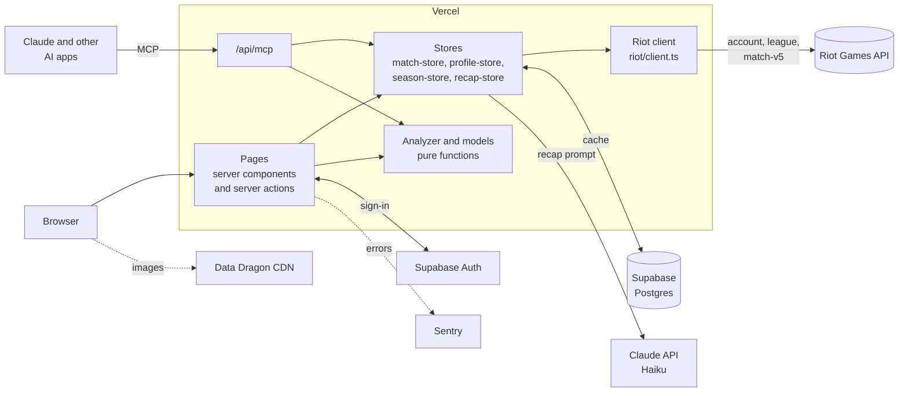
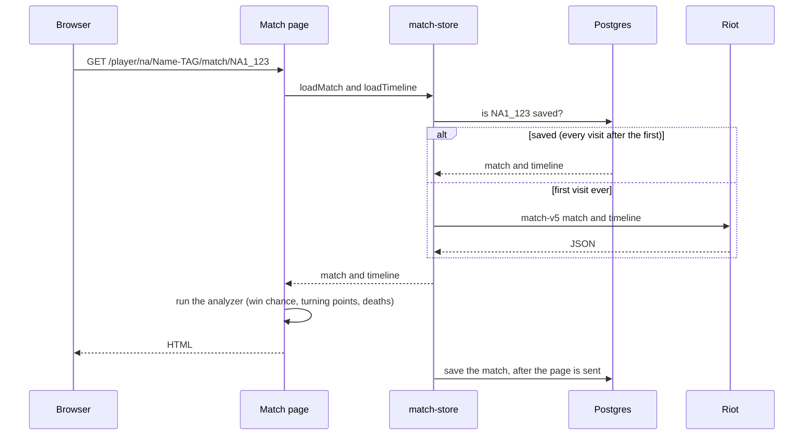

# Architecture

How Turnpoint's pieces fit together, and what happens when someone opens a page. For the features themselves see the [README](README.md); for the data model see [docs/SCOPE.md](docs/SCOPE.md).

## The short version

Turnpoint is one Next.js app on Vercel. The browser never talks to Riot: every page is built on the server, which reads from a Postgres cache first and only asks Riot for what's missing. The analysis itself is pure TypeScript that runs on the saved match every time, so it never needs to be stored.

## Three layers

Every request goes down the same three layers. Each layer only calls the one below it.

| Layer | Files | Job |
|---|---|---|
| **Pages** | `src/app/` | Read the URL, ask the stores for data, run the analyzer, render HTML. `/api/mcp` is a page too, it just answers AI apps with text instead of HTML. |
| **Stores** | `src/lib/*-store.ts` | Decide where data comes from: Postgres if it's saved and still fresh, otherwise Riot. Save what Riot returns. |
| **Riot client** | `src/lib/riot/` | The only code that calls Riot. Waits its turn under the rate limit, adds the key, times out after 8 seconds, retries server errors, and backs off when Riot says "too many requests". |

The **analyzer** (`src/lib/analyzer/`) sits beside these layers, not under them. It takes match JSON and returns results, with no network or database, which is why it has the most tests.

Files that touch the Riot key or the database start with `import "server-only"`, so the build fails if a browser component ever imports one.

## What happens when you open a match

The save happens with Next.js's `after()`, so the visitor never waits for the database write. If the database is down or not set up, the page still works by asking Riot, and the failure goes to Sentry.

## Caching rules

| Data | Kept for | Why |
|---|---|---|
| Finished matches and timelines | Forever | A game never changes once it's over. |
| A player's profile (rank, latest match IDs) | 1 day, or until someone clicks Update | Rank changes, but not every minute. Update has a 2 minute cooldown so nobody can spend the rate limit by clicking. |
| AI recaps | Forever | The match doesn't change, so neither does the recap. Capped at 20 new ones per account per day. |
| Analysis results | Not stored | Recomputed on every visit, so improving the analyzer never means refetching anything. |

The rules live in `src/db/freshness.ts`.

## Staying inside Riot's rate limit

A development key allows 20 requests a second and 100 every 2 minutes, per region, and a brand new player can take 20 or more. Four things keep Turnpoint inside that:

1. **The cache.** Most visits cost zero Riot calls.
2. **A budget per page.** Insights and season stats fetch only a few missing games per visit and fill in the rest over the next few loads, so a 100-game view can't use the whole allowance at once.
3. **Counting before calling, shared by every server.** Vercel runs several copies of the app at once, and none of them can see the others' memory. So the count lives in Postgres: one row per Riot region in `riot_rate_limits`, holding how many requests each of Riot's windows has used. Before every request the client locks that row, asks a pure function (`takeTurn` in `src/lib/riot/rate-limit.ts`) whether one more fits, and saves the new count. Locking the row means two servers asking at the same moment take turns, so they can't both spend the last request in a window. A short wait (the per-second limit) is slept through; a long one (the 2 minute window is used up) fails right away with "try again in N seconds".
4. **Backing off.** After a "too many requests" answer, the client refuses to call that region again until Riot's `Retry-After` time has passed, and saves that time in the same row so every server waits. Riot can disable keys that keep calling after being told to stop.

The count is an extra, like the cache: if the database is missing or slow (over a second), the request goes ahead and Riot's own answer is the safety net.

## Models

The game score and win chance are trained offline by scripts (`npm run train-score`, `npm run train-win-chance`) on games saved in Postgres. The scripts write the learned weights to JSON files in `src/lib/analyzer/`, and the site only loads those weights, so a prediction is a few multiplications with no model server.

## Known limits

These are fine for a portfolio site's traffic, and are the next things to fix before a production Riot key brings more:

- **Every Riot request costs a database round trip** for the shared count, a few milliseconds next to Riot's hundreds. At much higher traffic, Redis would be the usual home for a counter like this.
- **The limits are written in the code** (`RIOT_LIMITS`), set for a development key. A production key allows more, so they need changing when the key does.
- **`/api/mcp` has no request limit.** An AI app looking up many new players could spend the Riot allowance for everyone.
- **One free database.** Supabase's free tier holds 500 MB and has no downloadable backups. Matches can be fetched again, but accounts, goals and notes can't.
- **No uptime check.** Sentry reports errors, but nothing alerts when the site is down or the daily dev key has expired.

## Saying it in an interview

> Turnpoint is a Next.js app on Vercel. Pages render on the server so the Riot API key never reaches the browser. Each request goes through a store layer that reads from a Postgres cache first: finished matches never change, so they're fetched from Riot once and kept forever, while profiles expire after a day. Every Riot call goes through one client that handles timeouts and retries, and counts requests against Riot's rate limit in Postgres before calling, because serverless instances can't see each other's memory. The analysis is pure TypeScript functions that run on the saved match every time, so they're easy to unit-test and improving them never costs API calls. The two models are logistic regressions trained offline, shipped as JSON weights. At much higher traffic I'd move that counter to Redis, since every Riot call now costs a database round trip.
