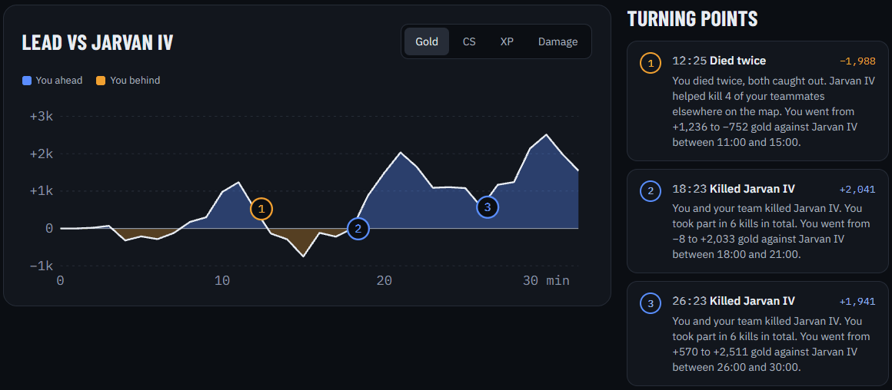
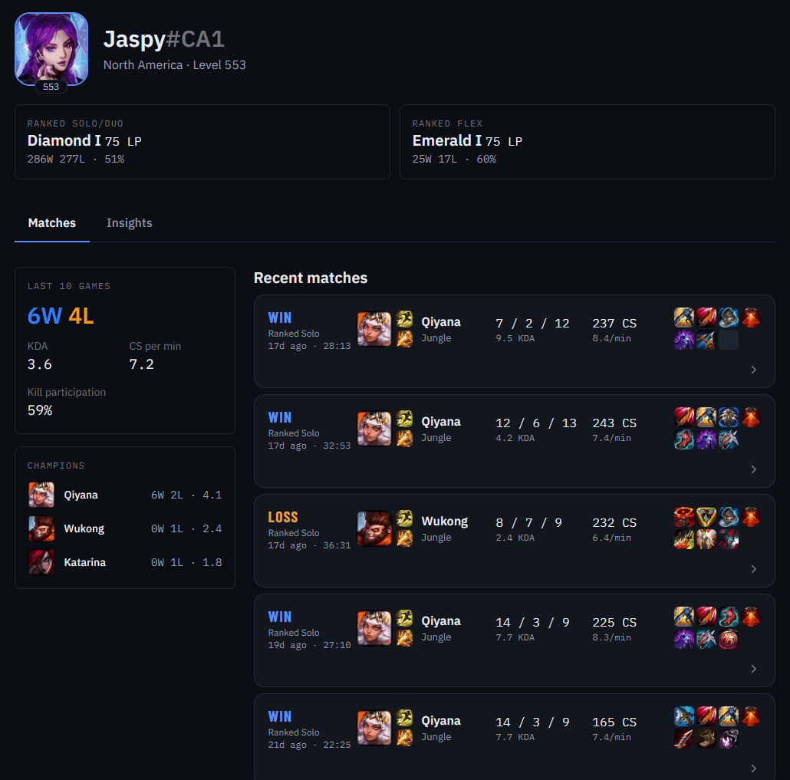
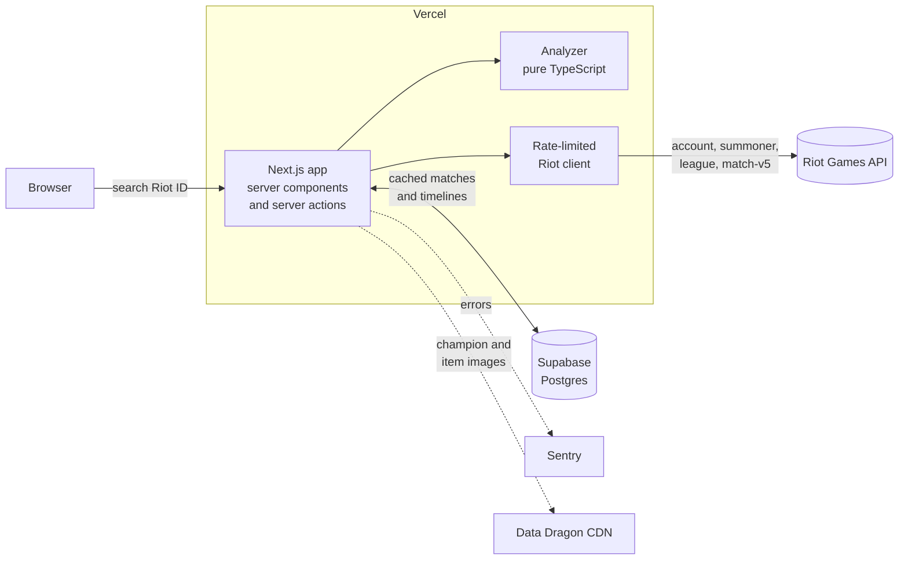

# Turnpoint

**Find out why you won or lost.** Turnpoint looks up any League of Legends player by Riot ID and breaks each game down minute by minute against the opponent in their role, so you can see exactly where it turned.

[](https://github.com/Jaspyplayz/League-Web-App/actions/workflows/ci.yml)
[](LICENSE)

**Live site:** https://league-web-app.vercel.app



## Why Turnpoint

Stats sites tell you *what* happened: your KDA, your CS, whether you won. Turnpoint is built to tell you *why*. It compares you to the enemy player in the same role, one minute at a time, and points at the moments that decided the game:

> **8:00 to 12:00:** you fell from +300 to −900 gold. You died twice, both times to the enemy jungler.

Across your recent games it turns those moments into patterns you can act on, like "you're behind in CS at 10 minutes in 14 of your last 20 games."

## Features

| Feature | Status |
|---|---|
| Search any player by Riot ID (`GameName#TAG`) and region | ✅ Built |
| Shareable player URLs (`/player/kr/Faker-KR1`) | ✅ Built |
| Player profile: rank, level, champions and recent matches | ✅ Built |
| Match detail: full scoreboard for all 10 players | ✅ Built |
| **Match analyzer:** gold, CS, XP and damage difference vs your role opponent, per minute | ✅ Built |
| **Turning points:** the 1 to 3 biggest swings in a game, each with a plain-English reason | ✅ Built |
| Death breakdown: solo killed, ganked, teamfight or caught | ✅ Built |
| Team gold over time, with dragons, Baron, towers and other objectives | ✅ Built |
| **Insights tab:** trends and recurring weaknesses across your last 20 games | ✅ Built |
| Shareable match card image | Planned |



The **Insights** tab looks across your last 20 games: your gold against your opponent at 10 minutes in each game, how often you win when ahead or behind, how you die early, and how your CS holds up later in games. Simple, tested rules turn those into a "recurring weaknesses" card.


## How the match analyzer works

The analyzer is the core of the project. The full research and design is in [docs/match-analyzer.md](docs/match-analyzer.md); here's the short version.

1. **Get the data.** Riot's match timeline API has a snapshot of every player's gold, CS, XP and position for every minute of a game, plus a timestamped list of every kill, objective and item purchase.
2. **Find your opponent.** The player on the enemy team in the same role (top, jungle, mid, bot or support).
3. **Build the difference curves.** Your gold, CS and XP minus theirs, minute by minute. Above zero means you're ahead.
4. **Find turning points.** Slide a window over the gold curve, keep the biggest swings, and explain each one from the events inside that window (deaths, ganks, tower plates, objectives).
5. **Roll it up.** Across your recent games, apply simple, tested rules like "behind at 10 minutes in most games" to surface recurring weaknesses.

**Why compare to the opponent in your role?** Riot's API has no "average Gold-rank player" benchmark, and building one would mean crawling thousands of games. The enemy in your role is at roughly the same rank, on the same patch, in the same game. It's also how pro analysts talk about laning.

## Tech stack

| Technology | Role | Why | Status |
|---|---|---|---|
| [Next.js 16](https://nextjs.org) (App Router) + TypeScript | UI and server code | One codebase for pages and API logic. Server components keep the Riot API key off the browser. | ✅ In use |
| [Tailwind CSS 4](https://tailwindcss.com) | Styling | Fast to build a consistent UI without writing a design system from scratch. | ✅ In use |
| [Vitest](https://vitest.dev) | Unit tests | Fast, TypeScript-native, and a natural fit for testing the analyzer's pure functions. | ✅ In use |
| [GitHub Actions](https://github.com/features/actions) | CI | Lint, type check, test and build on every pull request. | ✅ In use |
| [Vercel](https://vercel.com) | Hosting | Zero-config Next.js hosting, automatic deploys from `main`, and a preview link for every PR. | ✅ In use |
| [Riot Games API](https://developer.riotgames.com) | Player and match data | The official source for accounts, ranks, matches and timelines. | ✅ In use |
| [Supabase](https://supabase.com) Postgres + [Drizzle ORM](https://orm.drizzle.team) | Match cache | Matches never change once played, so storing them avoids refetching and keeps us inside Riot's rate limits. | ✅ In use |
| [Sentry](https://sentry.io) | Error tracking | Reports crashes on the live site with the exact error and stack trace. | ✅ In use |
| Hand-written SVG | Charts | The gold, CS and XP curves are simple enough that a chart library wasn't worth the extra JavaScript. | ✅ In use |
| [Playwright](https://playwright.dev) | End-to-end tests | One browser test of the search flow. | Planned |

Everything runs on free tiers.

## Architecture



**Key design decisions**

- **The API key never reaches the browser.** All Riot calls happen on the server, in server components and server actions.
- **Cache forever what never changes.** A finished match and its timeline are permanent, so they're stored once in Postgres. Only things that do change (rank, the latest match list) get short cache lifetimes.
- **One client for every Riot call, and a budget per page.** A development or personal API key allows 100 requests every 2 minutes, and loading one new player can take 20+ calls. The client backs off for as long as Riot asks after a `429`, and the Insights page fetches at most 5 new timelines per load, filling in the rest over a few automatic reloads.
- **The analyzer is pure functions.** Match JSON in, insights out: no network, no database. That makes it easy to unit-test against saved real games.
- **Analysis is recomputed, not stored.** The analyzer runs on the stored match and timeline every time, so improving it never means refetching anything from Riot.

The data model and the reasoning behind each choice are in [docs/SCOPE.md](docs/SCOPE.md).

## Project structure

```
src/
  app/                          Next.js routes (App Router)
    page.tsx                    Home page with the search form
    actions.ts                  Server action that validates a search and redirects
    player/[region]/[riotId]/   Player profile page
      match/[matchId]/          Match analysis page
      insights/                 Trends across the last 20 games
  components/                   React components (charts, match rows, icons, tabs)
  db/                           Drizzle schema and database connection
  lib/                          Plain TypeScript helpers, most with a .test.ts
    analyzer/                   The match analyzer: pure functions, match JSON in, insights out
    riot/                       Server-only Riot API client and one function per endpoint
    match-store.ts              Load matches and timelines from Postgres, falling back to Riot
    match-summary.ts            Turn match JSON into KDA, CS/min, records and labels
    ddragon.ts                  Champion names and image URLs from Data Dragon
    regions.ts                  Region list and Riot's platform/regional routing
    riot-id.ts                  Parse and validate "GameName#TAG", build URL slugs
docs/
  SCOPE.md                      Scope, data model, stack and build order
  match-analyzer.md             Analyzer research: Riot data, insights, rate limits
  database.md                   Database tables and setup
```

## Running locally

You need [Node.js 22](https://nodejs.org) or newer and a Riot API key from the [Riot developer portal](https://developer.riotgames.com) (a free development key works).

```bash
git clone https://github.com/Jaspyplayz/League-Web-App.git
cd League-Web-App
npm install
cp .env.example .env.local   # then paste your Riot API key into .env.local
npm run dev
```

Open http://localhost:3000.

`.env.local` is ignored by git, so your key is never committed. Development keys expire every 24 hours; regenerate one in the portal when requests start failing.

The key is only read on the server and never sent to the browser. For the live site, add `RIOT_API_KEY` in Vercel under Project → Settings → Environment Variables (Production and Preview), then redeploy.

## Testing and CI

| Command | What it does |
|---|---|
| `npm run dev` | Start the dev server |
| `npm run build` | Production build |
| `npm run lint` | ESLint |
| `npm run typecheck` | TypeScript type check |
| `npm test` | Unit tests (Vitest) |

[GitHub Actions](.github/workflows/ci.yml) runs lint, type check, tests and a production build on every pull request and every push to `main`. Vercel deploys `main` to the live site and builds a preview for each pull request.

Current tests cover Riot ID parsing and URL slugs, region routing, the Riot client (errors, retries, rate limits), match summaries, cache freshness, and every part of the analyzer: finding your opponent, labeling deaths, turning points, objectives and the cross-game trends. The analyzer tests use small made-up games; testing against saved real games is next.

## Roadmap

- [x] Scope the app and pick the standout feature ([SCOPE.md](docs/SCOPE.md))
- [x] Research the match analyzer ([match-analyzer.md](docs/match-analyzer.md))
- [x] Scaffold Next.js, TypeScript, Tailwind, tests and CI
- [x] Deploy to Vercel
- [x] Riot API client with rate limiting, and a real player profile
- [x] Supabase schema and match caching
- [x] Sentry error tracking
- [x] Match detail page with the scoreboard
- [x] Match analyzer: opponent comparison chart, @10/@15 snapshot, turning points
- [x] Insights tab with cross-game trends
- [ ] Analyzer tests against saved real games
- [ ] End-to-end test of the search flow
- [ ] Riot production API key and a custom domain

**Later ideas:** where-you-die heatmaps, item timing vs your own average, vision timelines, champion-specific advice.

## Legal

Turnpoint isn't endorsed by Riot Games and doesn't reflect the views or opinions of Riot Games or anyone officially involved in producing or managing Riot Games properties. Riot Games and all associated properties are trademarks or registered trademarks of Riot Games, Inc.

## Author

Built by Jasper ([@Jaspyplayz](https://github.com/Jaspyplayz)), a second-year student at the University of Toronto.
<!-- Add a LinkedIn or portfolio link here. -->

Released under the [MIT License](LICENSE).
