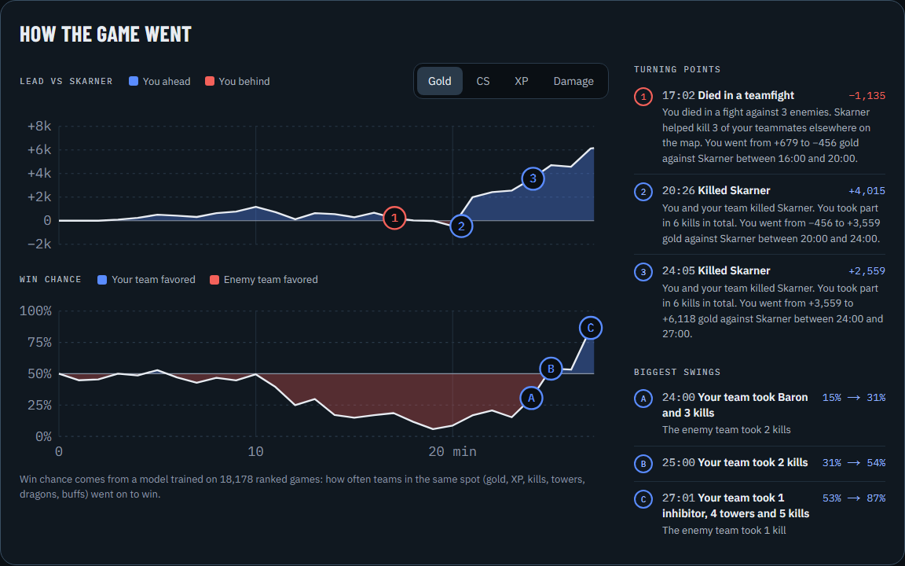
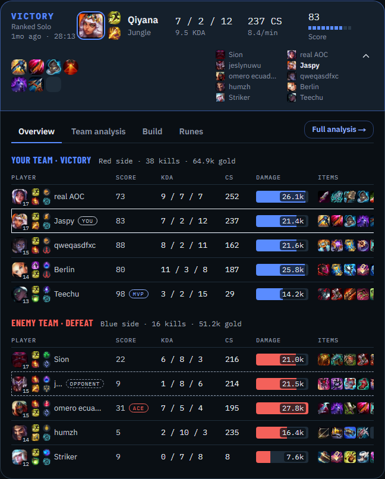
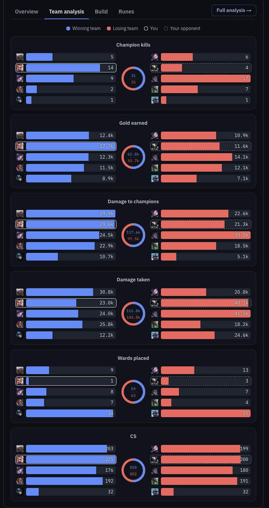
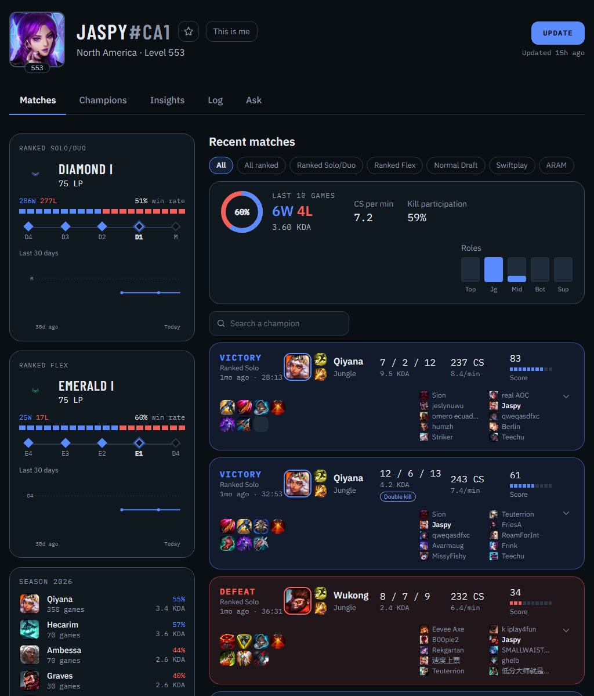
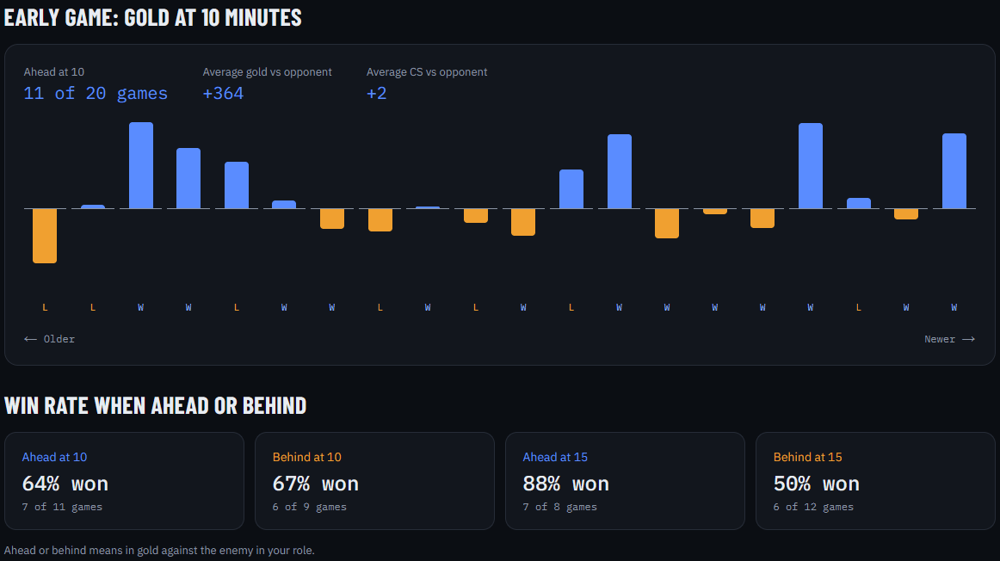
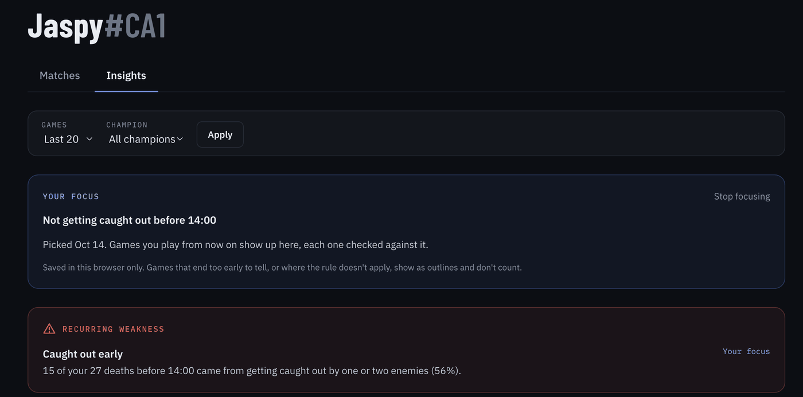
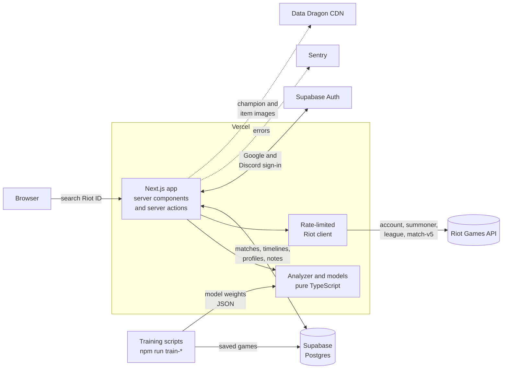

# Turnpoint

**Find out why you won or lost.** Turnpoint looks up any League of Legends player by Riot ID and breaks each game down minute by minute: each team's chance to win, your lead over the enemy in your role, and the turning points that decided it.

[](https://github.com/Jaspyplayz/League-Web-App/actions/workflows/ci.yml)
[](LICENSE)

**Live site:** https://league-web-app.vercel.app



## Why Turnpoint

Stats sites tell you *what* happened: your KDA, your CS, whether you won. Turnpoint is built to tell you *why*. It compares you to the enemy player in the same role, one minute at a time, and points at the moments that decided the game:

> **8:00 to 12:00:** you fell from +300 to −900 gold. You died twice, both times to the enemy jungler.

Across your recent games it turns those moments into patterns you can act on, like "you're behind in CS at 10 minutes in 14 of your last 20 games", and lets you pick one to work on.

## Features

### Match analysis

- **Win chance:** each team's chance to win at every minute, from a model trained on 4,000+ ranked games, with the three biggest swings and what caused them ("Baron took you from 41% to 68%").
- **Lead over your role opponent:** gold, CS, XP and damage difference, minute by minute.
- **Turning points:** the 1 to 3 biggest swings in your lane, each with a plain-English reason.
- **Deaths:** each one labeled solo killed, ganked, teamfight or caught.
- **Team gold** over time with dragons, Baron, towers and other objectives marked.
- **Replay (beta):** the whole game second by second on this season's Summoner's Rift, with every player's items and every play graded by the win chance.
- **Jungle pathing and early ganks:** which side of the map you played in the first minutes, and every gank before 14:00.
- Full scoreboard for all 10 players, and private notes on any game when signed in.



### Every game at a glance

- **Expandable match rows** with Overview, Team analysis, Build and Runes tabs, without leaving the profile.
- **Game score:** a trained 0 to 100 rating for every player, with **MVP** for the best winner and **ACE** for the best loser.
- **Badges** for standout games, and the winning team in blue, the losing team in red, with your row outlined.



### Player profile

- Rank emblems and a **30-day LP graph** for Solo/Duo and Flex.
- Win-rate ring and a summary of recent games.
- **Season champion stats** with champion search, and filters by game mode.
- Older games up to two months back, and an **Update** button for fresh data.
- Shareable URLs like `/player/kr/Faker-KR1`.



### Insights

- Trends across your last 20 to 100 games, and the **recurring weaknesses** they point to.
- **Compare with any rank**, Iron to Challenger, or with any player by Riot ID.
- Role-specific stats, including map control for junglers and supports (gank takedowns, objective share, time in the enemy half).
- **Focus goals:** pick one thing to improve and track it game by game.





### Accounts

- Sign in with Google or Discord, then mark a profile as **This is me**.
- Pinned players and recently viewed players, one click away.

## How it works

### The match analyzer

The analyzer is the core of the project: pure TypeScript functions, match JSON in, results out. The full research and design is in [docs/match-analyzer.md](docs/match-analyzer.md).

1. **Get the data.** Riot's match timeline has a snapshot of every player's gold, CS, XP and position for every minute of a game, plus a timestamped list of every kill, objective and item purchase.
2. **Find your opponent.** The player on the enemy team in the same role (top, jungle, mid, bot or support).
3. **Build the difference curves.** Your gold, CS and XP minus theirs, minute by minute. Above zero means you're ahead.
4. **Find turning points.** Slide a window over the gold curve, keep the biggest swings, and explain each one from the events inside that window (deaths, ganks, tower plates, objectives).
5. **Roll it up.** Across your recent games, simple tested rules like "behind at 10 minutes in most games" surface recurring weaknesses.

**Why compare to the opponent in your role?** The enemy in your role is at roughly the same rank, on the same patch, in the same game. It's also how analysts talk about laning. For a wider view, Insights compares you with games sampled from every rank, which a script collects through Riot's league endpoints (`npm run benchmarks`).

### Two small machine learning models

Both are logistic regression trained on games saved in the database, written from scratch in TypeScript (gradient descent, no ML library) and checked with 5-fold cross-validation on games they haven't seen.

| Model | What it reads | What it gives | How good |
|---|---|---|---|
| **Win chance** ([docs](docs/win-chance.md)) | Both teams' gold, XP, kills, towers, inhibitors, dragons, Baron and Elder at each minute | Each team's chance to win at that minute | Picks the winner 80% of the time at 20 minutes, and is well calibrated |
| **Game score** ([docs](docs/game-score.md)) | Ten stats per player (KDA, kill participation, damage share, CS, vision...), compared with the player's role | A 0 to 100 score: where the player ranks among everyone in that role | Predicts the winner from stats alone 84% of the time |

The win chance's learned weights are worth a look: kills and towers are worth almost nothing on their own, because the gold they pay is already in the gold lead. [docs/win-chance.md](docs/win-chance.md) walks through one real minute of a game by hand. Retrain either model with `npm run train-win-chance` or `npm run train-score`. Win chance only ever runs on finished games, since Riot's policy doesn't allow predictions during a live game.

## Tech stack

| Technology | Role | Why |
|---|---|---|
| [Next.js 16](https://nextjs.org) (App Router) + TypeScript | UI and server code | One codebase for pages and API logic. Server components keep the Riot API key off the browser. |
| [Tailwind CSS 4](https://tailwindcss.com) | Styling | A consistent dark theme from a small set of design tokens. |
| [Riot Games API](https://developer.riotgames.com) | Player and match data | The official source for accounts, ranks, matches and timelines. |
| [Supabase](https://supabase.com) Postgres + [Drizzle ORM](https://orm.drizzle.team) | Match cache, profiles, notes | Matches never change once played, so storing them avoids refetching and keeps us inside Riot's rate limits. |
| [Supabase Auth](https://supabase.com/auth) | Google and Discord sign-in | Sign-in without storing any passwords ourselves. |
| [Vitest](https://vitest.dev) | Unit tests | Fast, TypeScript-native, and a natural fit for the analyzer's pure functions. |
| [GitHub Actions](https://github.com/features/actions) | CI | Lint, type check, test and build on every pull request. |
| [Vercel](https://vercel.com) | Hosting and analytics | Automatic deploys from `main`, a preview link for every PR, and page view counts. |
| [Sentry](https://sentry.io) | Error tracking | Reports crashes on the live site with the exact error and stack trace. |
| Hand-written SVG | Charts | The curves are simple enough that a chart library wasn't worth the extra JavaScript. |

Everything runs on free tiers.

## Architecture



**Key design decisions**

- **The API key never reaches the browser.** All Riot calls happen on the server, in server components and server actions.
- **Cache forever what never changes.** A finished match and its timeline are permanent, so they're stored once in Postgres. Only things that do change (rank, the latest match list) expire, after a day or when you press Update.
- **One client for every Riot call, and a budget per page.** A development or personal API key allows 100 requests every 2 minutes, and loading one new player can take 20+ calls. The client backs off for as long as Riot asks after a `429`, and slower pages like Insights fetch a few timelines per load, filling in the rest over a few automatic reloads.
- **The analyzer is pure functions.** Match JSON in, results out: no network, no database. That makes it easy to unit-test.
- **Analysis is recomputed, not stored.** The analyzer runs on the stored match every time, so improving it never means refetching anything from Riot.
- **Models ship as JSON.** Training runs offline from a script; the site only loads the learned weights, so a prediction is a few multiplications.

The data model and the reasoning behind each choice are in [docs/SCOPE.md](docs/SCOPE.md).

## Project structure

```
src/
  app/                          Next.js routes (App Router)
    page.tsx                    Home page with the search form
    player/[region]/[riotId]/   Player profile
      match/[matchId]/          Match analysis page
      insights/                 Trends across the last 20 to 100 games
    privacy/, terms/            Legal pages
  components/                   React components; ui/ holds small shared pieces
  db/                           Drizzle schema, connection and cache freshness rules
  lib/                          Plain TypeScript helpers, most with a .test.ts
    analyzer/                   The match analyzer, game score and win chance (pure functions)
    riot/                       Server-only Riot API client and one function per endpoint
    supabase/                   Sign-in clients
    match-store.ts              Load matches and timelines from Postgres, falling back to Riot
    profile-store.ts            A player's saved profile, the Update button and rank history
    trend-games.ts              Recent games summarized for Insights
    season-store.ts             Season champion stats
scripts/                        Benchmarks collection and model training
drizzle/                        Generated SQL migrations
docs/                           Design and research docs
```

## Getting started

### Requirements

- [Git](https://git-scm.com/downloads)
- [Node.js 22](https://nodejs.org) (pinned in [`.nvmrc`](.nvmrc) and `package.json`; CI and Vercel use the same version)
- A Riot API key from the [Riot developer portal](https://developer.riotgames.com) (a free development key works)
- Optional: a [Supabase](https://supabase.com) Postgres database for the match cache, and a code editor like [VS Code](https://code.visualstudio.com)

### Run it

```bash
git clone https://github.com/Jaspyplayz/League-Web-App.git
cd League-Web-App
npm install
cp .env.example .env.local   # then fill in .env.local (at least RIOT_API_KEY)
npm run db:migrate           # only if you set DATABASE_URL_DIRECT
npm run dev
```

Open http://localhost:3000.

`.env.local` is ignored by git, so your keys are never committed, and a fresh clone doesn't have them: copy them over yourself. Development keys expire every 24 hours; regenerate one in the portal when requests start failing.

**[docs/SETUP.md](docs/SETUP.md)** walks through every step: what each variable in `.env.local` is for and which are optional, the database, rank benchmarks, and fixes for Windows PowerShell.

The keys are only read on the server and never sent to the browser. For the live site, they're set in Vercel under Project → Settings → Environment Variables (Production and Preview), followed by a redeploy.

## Testing and CI

| Command | What it does |
|---|---|
| `npm run dev` | Start the dev server |
| `npm run build` | Production build |
| `npm run lint` | ESLint |
| `npm run typecheck` | TypeScript type check |
| `npm test` | Unit tests (Vitest) |
| `npm run benchmarks` | Collect games from every rank for Insights' comparisons |
| `npm run train-score` / `npm run train-win-chance` | Retrain the two models on saved games |

[GitHub Actions](.github/workflows/ci.yml) runs lint, type check, tests and a production build on every pull request and every push to `main`. Vercel deploys `main` to the live site and builds a preview for each pull request.

Around 40 test files cover Riot ID parsing and region routing, the Riot client (errors, retries, rate limits), cache freshness, rank history, filters, and every part of the analyzer: finding your opponent, labeling deaths, turning points, objectives, jungle pathing, cross-game trends, rank comparisons, the game score and the win chance.

## Roadmap

- [x] Match analyzer, turning points and Insights
- [x] Database cache, error tracking and CI
- [x] Expandable match rows, team analysis and the game score
- [x] Compare with any rank or any player, and Focus goals
- [x] Sign-in, This is me, pinned players and match notes
- [x] LP graph, season champions and older games
- [x] Win chance graph
- [ ] Analyzer tests against saved real games
- [ ] End-to-end test of the search flow
- [ ] Loading skeletons and a shareable match card image
- [ ] Riot production API key and a custom domain

The full list lives in [GitHub Issues](https://github.com/Jaspyplayz/League-Web-App/issues/23).

## Legal

Turnpoint isn't endorsed by Riot Games and doesn't reflect the views or opinions of Riot Games or anyone officially involved in producing or managing Riot Games properties. Riot Games and all associated properties are trademarks or registered trademarks of Riot Games, Inc.

## Author

Built by Jasper ([@Jaspyplayz](https://github.com/Jaspyplayz)), a second-year student at the University of Toronto.
<!-- Add a LinkedIn or portfolio link here. -->

Released under the [MIT License](LICENSE).
