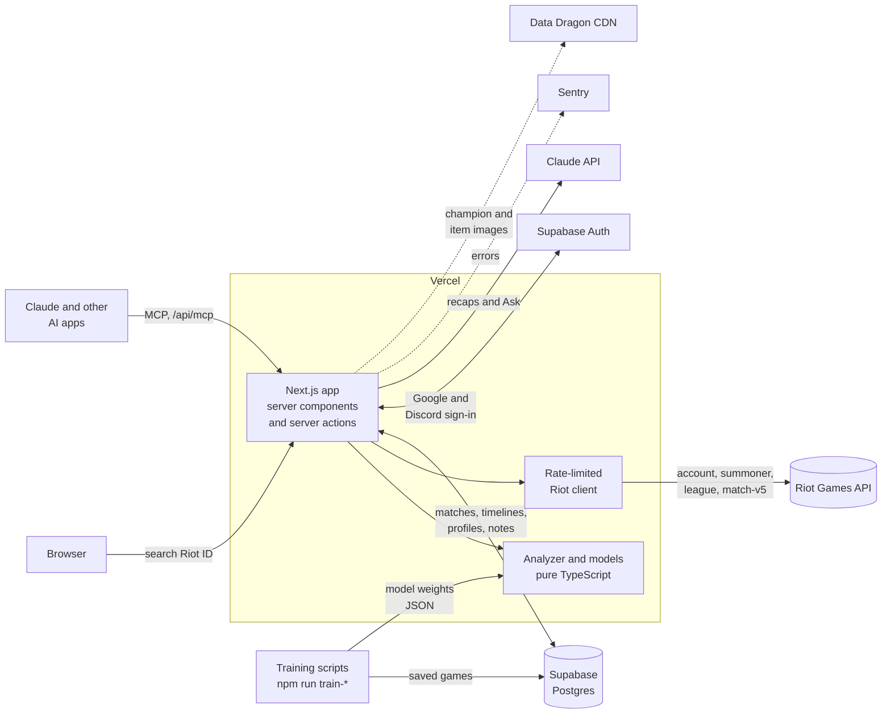

# Turnpoint

**Find out why you won or lost.** Turnpoint looks up any League of Legends player by Riot ID and breaks each game down minute by minute: each team's chance to win, your lead over the enemy in your role, and the turning points that decided it.

[](https://github.com/Jaspyplayz/League-Web-App/actions/workflows/ci.yml)
[](LICENSE)


**Live site:** https://league-web-app.vercel.app · **How the numbers work:** [/how-it-works](https://league-web-app.vercel.app/how-it-works)


## At a glance

- **What it is:** a full-stack Next.js app that turns Riot's raw match data into an explanation of each game, then into patterns across a player's recent games that they can work on.
- **The core:** a match analyzer written as pure TypeScript functions (match JSON in, results out), covered by unit tests and golden tests on four real games.
- **Machine learning from scratch:** a win chance model trained on 18,178 ranked games and a 0 to 100 game score, both logistic regression written by hand in TypeScript (no ML library) and checked on games they never saw.
- **Built to live within a strict API budget:** a Postgres-backed rate limiter shared by every server, and a cache that stores each finished match once, keep the site inside Riot's 100 requests per 2 minutes.
- **AI features:** Claude writes short match recaps from the analyzer's numbers, answers questions about a player's games through the same tools, and the site is an MCP server other AI apps can call.
- **Shipped and tested like a real product:** CI on every pull request, a browser smoke test and accessibility scan on every preview deploy, error tracking, and a preview link for every change.

## Features

### Match analysis

- **Win chance:** each team's chance to win at every minute, with the three biggest swings and what caused them ("Baron took you from 41% to 68%").
- **You vs your opponent:** gold, CS, XP and damage difference against the enemy in your role, minute by minute, with the turning points explained in plain English.
- **Phase ratings:** a 0 to 100 rating for your early, mid and late game, each saying what helped or held it back most.
- **60-second review:** the three plays you were in that moved the win chance most, each with a question to think over and a jump into the replay.
- **Replay (beta):** the whole game second by second on Summoner's Rift, with every player's items and position, and every play graded by how much it moved the win chance.
- **Deaths, ganks and jungle pathing:** each death labeled (solo killed, ganked, teamfight, caught), every gank before 14:00, and which side of the map the jungler started on.
- **AI recap:** a headline and a few timed points on what decided the game, written by Claude from the analyzer's facts.

### Every game at a glance

- **Expandable match rows** with Overview, Team analysis, Build and Runes tabs, without leaving the profile.
- **Game score:** a trained 0 to 100 rating for all ten players, with **MVP** for the best winner and **ACE** for the best loser.


### Player profile

- Rank emblems, a **30-day LP graph**, a win-rate ring and a summary of recent games.
- **Champions tab:** season stats per champion and against each enemy champion.
- **Log tab:** one card per day you played, with notes.
- Shareable URLs like `/player/kr/Faker-KR1`.


### Insights

- Trends across your last 20 to 100 games, and the **recurring weaknesses** they point to.
- **Compare with any rank**, Iron to Challenger, or with any player by Riot ID.
- **Habits:** level 6 first, first scuttles, early ganks and first back, with how often games with each were won.
- **Session blocks:** win rate and game score by how many games you played in a row.
- **What keeps killing you:** the champions, abilities and damage types behind most of your deaths.
- **Focus goals:** pick one thing to improve and track it game by game.


### Accounts and AI

- Sign in with Google or Discord, mark a profile as **This is me**, pin players and keep private notes on any game.
- **Ask:** signed-in players ask Claude questions like "What do my losses have in common?". Claude reads the games with Turnpoint's own tools and links the games it used. Daily and monthly spending caps keep the cost bounded.
- **MCP server** at `/api/mcp`: Claude and other AI apps can look players up and read the analyzer's results ([docs/mcp.md](docs/mcp.md)).

## How it works

### The match analyzer

The analyzer is the core of the project. The full research and design is in [docs/match-analyzer.md](docs/match-analyzer.md).

1. **Get the data.** Riot's match timeline has a snapshot of every player's gold, CS, XP and position for every minute, plus a timestamped list of every kill, objective and item purchase.
2. **Find your opponent.** The player on the enemy team in the same role.
3. **Build the difference curves.** Your gold, CS and XP minus theirs, minute by minute. Above zero means you're ahead.
4. **Find turning points.** Slide a window over the gold curve, keep the biggest swings, and explain each one from the events inside that window (deaths, ganks, tower plates, objectives).
5. **Roll it up.** Across your recent games, simple tested rules like "behind at 10 minutes in most games" surface recurring weaknesses.

**Why compare to the opponent in your role?** They're at roughly the same rank, on the same patch, in the same game, and it's how analysts talk about laning. For a wider view, Insights compares you with games sampled from every rank (`npm run benchmarks`).

### The models

All three are logistic regression trained offline on saved games, written from scratch in TypeScript (gradient descent, no ML library) and checked with 5-fold cross-validation. The site ships only the learned weights as JSON, so a prediction is a few multiplications.

| Model | Reads | Gives | Checked on |
|---|---|---|---|
| **Win chance** ([docs](docs/win-chance.md)) | Both teams' gold, XP, kills, towers, inhibitors, dragons, Baron and Elder at each minute | Each team's chance to win at that minute | 18,178 ranked games, Iron to Challenger. Well calibrated: when it says 90 to 100%, that team wins 96% of the time. A fairer evaluation that leaves out each game's final minutes is planned ([why](docs/win-chance.md#how-good-is-it)) |
| **Game score** ([docs](docs/game-score.md)) | Ten stats per player (KDA, kill participation, damage share, CS, vision...), compared with the player's role | A 0 to 100 percentile among players in that role | Picks the winning side from stats alone 81% of the time on 35,326 games it didn't train on |
| **Phase ratings** ([docs](docs/phase-ratings.md)) | The same recipe, on each player's stats in one phase of the game | Early, mid and late game ratings | Picks the winner 62% of the time from the early game alone, 73% from mid and 81% from late, on games it didn't train on |

The win chance's learned weights are worth a look: kills and towers are worth almost nothing on their own, because the gold they pay is already in the gold lead. [docs/win-chance.md](docs/win-chance.md) walks through one real minute of a game by hand. Win chance only ever runs on finished games, since Riot's policy doesn't allow predictions during a live game.

## Tech stack

| Technology | Role | Why |
|---|---|---|
| [Next.js 16](https://nextjs.org) (App Router) + TypeScript | UI and server code | One codebase for pages and server logic. Server components keep the Riot API key off the browser. |
| [Tailwind CSS 4](https://tailwindcss.com) | Styling | Dark and light themes from one set of design tokens. |
| [Supabase](https://supabase.com) Postgres + [Drizzle ORM](https://orm.drizzle.team) | Match cache, profiles, notes, rate limit counts | Matches never change once played, so storing them avoids refetching and keeps the site inside Riot's rate limits. |
| [Supabase Auth](https://supabase.com/auth) | Google and Discord sign-in | Sign-in without storing any passwords. |
| [Riot Games API](https://developer.riotgames.com) | Player and match data | The official source for accounts, ranks, matches and timelines. |
| [Claude API](https://docs.anthropic.com) + [MCP](https://modelcontextprotocol.io) | Recaps, Ask, and the MCP server | Claude writes from the analyzer's tested numbers instead of the raw match. |
| [Vitest](https://vitest.dev), [Playwright](https://playwright.dev) + [axe](https://github.com/dequelabs/axe-core) | Unit, golden, browser and accessibility tests | Fast tests for the pure analyzer; a real browser check of every preview deploy. |
| [GitHub Actions](https://github.com/features/actions) | CI | Lint, type check, test and build on every pull request, plus dependency review. |
| [Vercel](https://vercel.com) | Hosting and analytics | Automatic deploys from `main` and a preview link for every pull request. |
| [Sentry](https://sentry.io) | Error tracking | Reports crashes on the live site with the exact error and stack trace. |
| Hand-written SVG | Charts | The curves are simple enough that a chart library wasn't worth the extra JavaScript. |

Everything runs on free tiers.

## Architecture



**Key design decisions**

- **The API key never reaches the browser.** All Riot calls happen on the server. Files that touch a secret import `server-only`, and a custom ESLint rule keeps Riot hosts out of every other folder.
- **Cache forever what never changes.** A finished match and its timeline are stored once in Postgres. Only things that change (rank, the latest match list) expire, after a day or when you press Update.
- **One client for every Riot call.** A development key allows 100 requests every 2 minutes, and loading one new player can take 20+ calls. The client takes a turn from a counter in Postgres before each call, so every server on Vercel shares one budget, and it backs off for as long as Riot asks after a `429`.
- **The analyzer is pure functions.** No network, no database, which makes it easy to test, and it runs on the stored match every time, so improving it never means refetching anything.
- **Models ship as JSON.** Training runs offline from a script; the site only loads the learned weights.

**[ARCHITECTURE.md](ARCHITECTURE.md)** walks through what happens when you open a match, the caching rules, the rate limiter and the known limits. The data model is in [docs/SCOPE.md](docs/SCOPE.md) and the tables in [docs/database.md](docs/database.md).

## Project structure

```
src/
  app/                          Next.js routes (App Router)
    page.tsx                    Home page with the search form
    player/[region]/[riotId]/   Player profile, with Insights, Champions, Log and Ask tabs
      match/[matchId]/          Match analysis page (Summary and Deep dive tabs)
    api/mcp/                    The MCP server
    how-it-works/               How the analyzer and models work, for players
    privacy/, terms/            Legal pages
  components/                   React components; ui/ holds small shared pieces
  db/                           Drizzle schema, connection and cache freshness rules
  lib/                          Plain TypeScript helpers, most with a .test.ts beside them
    analyzer/                   The match analyzer, replay and models (pure functions)
    riot/                       Server-only Riot API client and rate limiter
    mcp/                        Tools shared by the MCP server and Ask
    *-store.ts                  Load and save data: Postgres first, Riot when missing
drizzle/                        Generated SQL migrations
scripts/                        Benchmark collection, model training and data checks
e2e/                            Playwright smoke test and accessibility scan
eslint-rules/                   Project lint rules (server-only secrets, Riot hosts, colors)
docs/                           Design and research docs, and decision records in adr/
```

The file-by-file map is in [ARCHITECTURE.md](ARCHITECTURE.md#where-the-code-lives).

## Getting started

### Requirements

- [Node.js 22](https://nodejs.org) (pinned in [`.nvmrc`](.nvmrc) and `package.json`)
- A Riot API key from the [Riot developer portal](https://developer.riotgames.com) (a free development key works)
- Optional: a [Supabase](https://supabase.com) Postgres database for the match cache and sign-in, and an Anthropic API key for the AI features

### Run it

```bash
git clone https://github.com/Jaspyplayz/League-Web-App.git
cd League-Web-App
npm install
cp .env.example .env.local   # then fill in .env.local (at least RIOT_API_KEY)
npm run db:migrate           # only if you set DATABASE_URL_DIRECT
npm run dev
```

Open http://localhost:3000. Features whose keys are missing hide themselves: no Supabase values means no "Sign in", no Anthropic key means no "Write recap".

`.env.local` is ignored by git, so keys are never committed. Development keys expire every 24 hours; regenerate one in the portal when requests start failing. [docs/SETUP.md](docs/SETUP.md) walks through every variable, the database and fixes for Windows PowerShell.

## Testing and CI

| Command | What it does |
|---|---|
| `npm run dev` | Start the dev server |
| `npm run lint` | ESLint, plus the project's own rules in `eslint-rules/` |
| `npm run typecheck` | TypeScript type check |
| `npm test` | Unit tests (Vitest), including golden tests on four real games |
| `npm run test:e2e` | Playwright smoke test and accessibility scan |
| `npm run build` | Production build |
| `npm run train-win-chance` / `train-score` / `train-phase-score` | Retrain a model on saved games |
| `npm run benchmarks` | Collect games from every rank for Insights' comparisons |

[GitHub Actions](.github/workflows/ci.yml) runs lint, type check, tests and a production build on every pull request and every push to `main`, and [dependency review](.github/workflows/dependency-review.yml) checks new packages for known vulnerabilities. When Vercel finishes a preview deploy, [the smoke test](.github/workflows/smoke.yml) opens it in a real browser and runs an [axe](https://github.com/dequelabs/axe-core) accessibility scan in both themes, which fails on any error.

About 90 test files cover Riot ID parsing and region routing, the Riot client (errors, retries, rate limits), cache freshness, and every part of the analyzer: finding your opponent, labeling deaths, turning points, objectives, jungle pathing, the replay, trends, rank comparisons and all three models.

## How it's built

Turnpoint is built with [Claude Code](https://claude.com/claude-code) as a pair programmer. Every change goes through a pull request with a plain-language walkthrough, CI, a preview deploy and, for anything beyond docs, a review by a separate reviewer agent before merging. Riskier changes (database, sign-in, anything that spends API money) also get a second model's review and a manual test of the preview. The process, and the reasons behind it, are in [docs/workflow.md](docs/workflow.md) and the [decision records](docs/adr/).

## Documentation

| Doc | What's in it |
|---|---|
| [ARCHITECTURE.md](ARCHITECTURE.md) | How the pieces fit together, with diagrams |
| [docs/match-analyzer.md](docs/match-analyzer.md) | The analyzer's research and design |
| [docs/win-chance.md](docs/win-chance.md), [docs/game-score.md](docs/game-score.md), [docs/phase-ratings.md](docs/phase-ratings.md) | The three models: features, training and how good they are |
| [docs/replay.md](docs/replay.md), [docs/tempo.md](docs/tempo.md) | The replay and the jungle tempo study |
| [docs/match-recap.md](docs/match-recap.md), [docs/ask.md](docs/ask.md), [docs/mcp.md](docs/mcp.md) | The AI features and their cost limits |
| [docs/database.md](docs/database.md), [docs/SCOPE.md](docs/SCOPE.md) | Tables, migrations and the data model |
| [docs/SETUP.md](docs/SETUP.md) | Setup on a new computer |

## What's next

- A Riot production API key, then sign-in with a Riot account.
- A fairer win chance evaluation that leaves out each game's final minutes.
- The site in Korean, Spanish and Portuguese.

## Legal

Turnpoint isn't endorsed by Riot Games and doesn't reflect the views or opinions of Riot Games or anyone officially involved in producing or managing Riot Games properties. Riot Games and all associated properties are trademarks or registered trademarks of Riot Games, Inc.

## Author

Built by Jasper ([@Jaspyplayz](https://github.com/Jaspyplayz)), a second-year student at the University of Toronto.
<!-- Add a LinkedIn or portfolio link here. -->

Released under the [MIT License](LICENSE).
